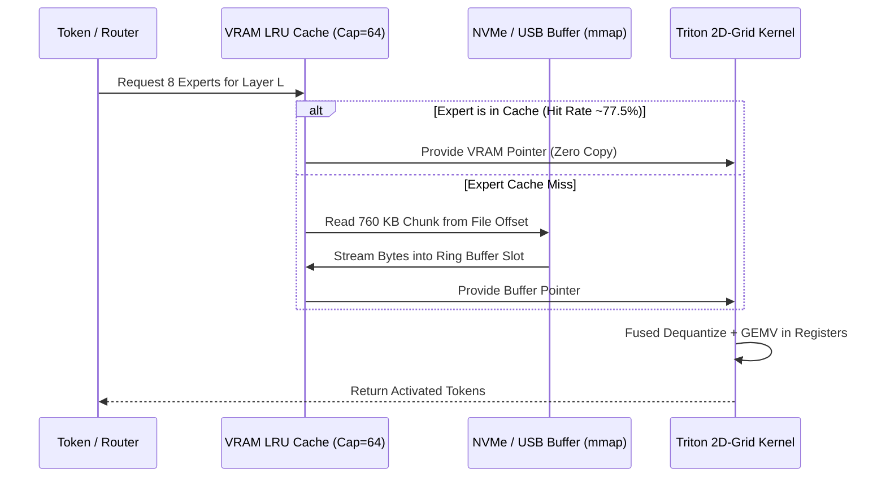

# 🏛️ VQ2 & LEGION AI Architecture Manual

This document provides a deep technical reference for the mathematics, data structures, container specifications, and runtime kernel mechanics of **VQ2** and **LEGION AI**.

---

## 1. Mathematical Formulation

### 1.1 Randomized Hadamard Transform (RHT)
Weight matrices in modern LLMs exhibit extreme kurtosis—certain activation channels concentrate orders of magnitude more energy than others ("activation outliers"). Scalar quantization truncates or distorts these channels.

To neutralize outliers without adding model parameters, VQ2 applies an orthogonal rotation $R$ to the input dimension of each weight matrix $W \in \mathbb{R}^{d_{out} \times d_{in}}$:
$$W' = W \cdot R$$
where $R$ is constructed as:
$$R = P \cdot S \cdot H$$
* $P \in \mathbb{R}^{d_{in} \times d_{in}}$ is a pseudo-random permutation matrix.
* $S = \text{diag}(s_1, \dots, s_{d_{in}})$ is a Rademacher diagonal matrix ($s_i \in \{-1, +1\}$ with equal probability).
* $H$ is a normalized Walsh-Hadamard matrix computed in block chunks of $h_b = \min(2048, d_{in})$.

**Key Property**: Because $R$ is orthonormal ($R^T R = I$), Frobenius norm and inner products are strictly preserved:
$$\|W'\|_F = \|W\|_F, \quad \langle x, W \rangle = \langle R^T x, W' \rangle$$
The kurtosis of $W'$ drops to ~3.0 (standard Gaussian), distributing energy isotropically across all dimensions. During inference, the input activation $x$ is rotated via $x' = R^T x$ prior to vector lookup.

---

### 1.2 Hessian LDLQ Error Compensation
Quantizing weights directly using Frobenius distance ($\|W - \hat{W}\|_F^2$) ignores the non-uniform curvature of the loss surface. The functional error at the output of layer $l$ is:
$$\mathcal{L}_{func} = \mathbb{E}\left[ \|(W - \hat{W}) X\|_2^2 \right] = \text{Tr}\left( (W - \hat{W}) H (W - \hat{W})^T \right)$$
where $H = \mathbb{E}[X X^T]$ is the empirical Hessian matrix of layer inputs.

VQ2 quantizes weights in consecutive blocks of $D = 8$ dimensions. For each quantized block $j$, the quantization residual $E_j = \hat{W}_j - W_j$ is compensated across the remaining unquantized columns using the Cholesky LDL decomposition of the damped inverse Hessian:
$$H^{-1} = L D L^T$$
$$W_{rest} \leftarrow W_{rest} - E_j \cdot \frac{H^{-1}_{j, rest}}{H^{-1}_{j, j}}$$
This ensures that 1st- and 2nd-order functional output errors cancel out sequentially.

---

### 1.3 Residual Vector Quantization (RVQ 8-D)
Weights are grouped into vectors $v \in \mathbb{R}^8$.
* **Primary Stage (16-bit codebook)**:
  - $K_0 = 65,536$ centroids trained on GPU via spherical k-means++.
  - Encodes the coarse geometric vector in 8 dimensions (2.0 bpw).
* **Residual Stage (8-bit codebook)**:
  - $K_1 = 256$ centroids trained on the residual error $v - \mathcal{C}_0[i_0]$.
  - Adds fine precision (+1.0 bpw, totaling 3.0 bpw).

The reconstructed vector is:
$$\hat{v} = s \cdot \left( \mathcal{C}_0[i_0] + \mathcal{C}_1[i_1] \right)$$
where $s \in \mathbb{R}$ is a per-row learned floating-point scale.

---

### 1.4 Rate-Distortion Optimization (RDO)
Rather than applying a uniform bit budget across all layers, VQ2 profiles the sensitivity gradient per megabyte:
$$\lambda_l = \frac{\Delta\text{Distortion}_l}{\Delta\text{MB}_l} = \frac{\text{Tr}\left( (\tilde{W}_l - W_l) H_l (\tilde{W}_l - W_l)^T \right)}{\text{Size}(3.0\text{ bpw}) - \text{Size}(2.0\text{ bpw})}$$

**Empirical Finding**:
* `embed_tokens` (311M weights) has an extremely low sensitivity gradient ($\lambda \approx 0.000247$). Allocating 2.0 bpw saves 60.6 MB of VRAM with zero perceptible loss in reasoning.
* Self-attention projections (`k_proj`, `v_proj`, `out_proj`) have high gradients ($\lambda > 0.135$) and are preserved at 3.0 bpw.

---

## 2. Container Formats

### 2.1 `.vq2` (ANS Compressed Container)
Used for disk persistence and distribution with minimal file size.
* **Header**: Magic bytes `b"VQ2\x01"`, architecture metadata, layer count, vocabulary size.
* **Tensors**:
  - Codebooks $\mathcal{C}_0 \in \mathbb{R}^{65536 \times 8}$ (FP16), $\mathcal{C}_1 \in \mathbb{R}^{256 \times 8}$ (FP16).
  - Row scales $s \in \mathbb{R}^{d_{out}}$ (FP16).
  - Compressed index streams packed with Asymmetric Numeral Systems (ANS) via `constriction`.
  - Non-quantized dense layers (RMSNorm scales, router gates) in BF16.

### 2.2 `.vq2r` (Fast GPU Execution Container)
Optimized for instant cold-boot loading directly into GPU memory without ANS decompression overhead.
* Indices are stored pre-decoded as contiguous arrays of `uint16` ($i_0$) and `uint8` ($i_1$).
* Loads into GPU VRAM in **0.61 seconds** (sub-second cold boot).

### 2.3 `.vq2m` (Paged MoE Streaming Container)
Designed for memory-virtualized execution of massive Mixture-of-Experts models (e.g. Qwen3.8-35B with 10,240 experts).
* **64-bit Directory Header**: Fixed-offset lookup table containing file offsets and byte sizes for all 10,240 experts.
* **Contiguous Expert Shards**: Each expert occupies ~760 KB of raw VQ2 bytes.
* Mapped into user-space virtual memory via OS `mmap`.

---

## 3. Runtime Engine Mechanics

### 3.1 Triton 2D-Grid GEMV (`_parallel_moe_gemv`)
Conventional PyTorch dispatch suffers from sequential kernel launch overhead when routing through 8 active experts per layer.

VQ2 introduces a 2D execution grid in Triton:
$$\text{Grid} = \left( 8, \, \text{cdiv}(d_{out}, \text{BR}) \right)$$
* **Grid Dim 0 ($pid_e \in \{0, \dots, 7\}$)**: Indexes the 8 selected experts in parallel.
* Threads in all 28 SMs of the RTX 3060 execute simultaneously.
* Decompression is performed in register memory; intermediate dense weights are never written to global VRAM.
* **Measured Speedup**: Layer latency dropped from 8.66 ms to **0.744 ms** (11.6x faster).

---

### 3.2 LEGION Paged Streaming with LRU Cache

* **VRAM Bound**: Fixed static ring buffer (6.05 MB per layer).
* **Working Set**: With LRU capacity = 64, active VRAM is capped at **1,229 MB**, allowing 35B models to run comfortably on 4 GB–8 GB PCs.
