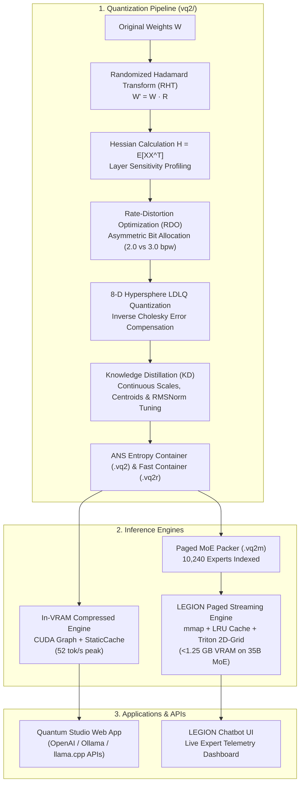

# ⚡ VQ2 & LEGION AI: Extreme Vector Quantization & Paged MoE Streaming Engine for LLMs

[](https://www.python.org/downloads/)
[](https://pytorch.org/)
[](https://developer.nvidia.com/cuda-toolkit)
[](https://github.com/openai/triton)
[](https://opensource.org/licenses/MIT)
[](CONTRIBUTING.md)
[](docs/)

> **Breaking the 4-bit barrier and the memory wall in Large Language Models.**  
> Compress LLMs to sub-3 bits per weight without functional collapse, and run 35B+ MoE models on consumer GPUs or streaming directly from external drives with less than 1.25 GB of active VRAM.

---

## 🌍 Language / Idioma
* [English](#english-overview) (Primary)
* [Português](#visão-geral-em-português) (Relatório Oficial e Guia)

---

<a name="english-overview"></a>
## 🚀 What is VQ2?

**VQ2 (Vector Quantization with Incoherence, RDO & Distillation)** is a next-generation open-source post-training vector quantization and runtime framework designed for deep neural networks and Mixture-of-Experts (MoE) LLMs.

Traditional quantization methods (such as GGUF Q4_K_M, AWQ, and GPTQ) treat weights as independent scalars. However, scalar quantization degrades severely below 4 bits per weight (bpw). VQ2 breaks this barrier by clustering weights in **8-dimensional hyperspheres**, combining:
1. **Randomized Hadamard Transform (RHT)** to completely disperse activation outliers into isotropic Gaussians.
2. **Output-Aware LDLQ Hessian Compensation** to eliminate 2nd-order functional error propagation across layer activations.
3. **Rate-Distortion Optimization (RDO)** for selective bit allocation per layer based on informational sensitivity.
4. **Differentiable Knowledge Distillation (KD)** fine-tuning continuous codebook centroids and RMSNorm scales against teacher logits.
5. **ANS (Asymmetric Numeral Systems)** entropy packaging into compact, high-efficiency containers (`.vq2`, `.vq2r`).
6. **Fused Triton 2D-Grid GEMV Kernels & CUDA Graphs** executing decompression entirely in register files on-the-fly.
7. **LEGION MoE Paged Streaming (`.vq2m`)**: A virtualized streaming engine that runs 35B+ MoE models with **10,240 experts** using memory-mapped I/O and LRU caching with **< 1.25 GB active VRAM**.

---

## 🏆 Key Milestones & Benchmarks

All evaluations conducted under identical conditions on an **NVIDIA GeForce RTX 3060 12GB**, using identical tokenizers and rigorous holdout evaluation splits (Wikitext-2 and Python standard library holdout).

### Milestone 1: Qwen3.5-2B Compressed to 567 MB (Beating GGUF Q4_K_M by 53.5%)

| Metric | 1. BF16 Original (Ref) | 2. GGUF Q4_K_M (Industry Standard) | 3. VQ2 Uniform (3.0 bpw) | 4. 🏆 VQ2 RDO 560MB (This Work) |
| :--- | :---: | :---: | :---: | :---: |
| **Model Disk Size** | 3,589.3 MB | 1,221.5 MB | 678.9 MB | **567.9 MB (`.vq2r`) / 566.4 MB (`.vq2`)** |
| **Reduction vs Q4_K_M** | — | *Baseline* | -44.4% | **-53.5% (More than half the size!)** |
| **Reduction vs BF16** | *Baseline* | -66.0% | -81.1% | **-84.2% (5.9x smaller)** |
| **Active GPU VRAM** | ~3,600 MiB | ~1,500 MiB | 696 MiB | **582 MiB (Weights: 561 MiB)** |
| **Cold Boot Load Time** | ~5.5 s | ~1.8 s | 2.93 s | **0.61 s (Sub-second!)** |
| **Wikitext-2 Test PPL** | 13.60 | **13.96** | 14.92 | **16.41** |
| **Python Code PPL (Holdout)** | 3.34 | **3.42** | 3.65 | **3.90** |
| **Top-1 Agreement vs BF16** | 100.0% | 92.9% | 86.0% | **81.3%** |
| **Effective Average BPW** | 16.0 bpw | ~5.45 bpw | 3.02 bpw | **2.525 bpw** |
| **Throughput (CUDA Graph)** | ~28 tok/s | ~30 tok/s | ~10 tok/s | **24.8 – 27.8 tok/s (Replay peak: 52.3 tok/s)** |

---

### Milestone 2: Qwen3.8-35B-A3B MoE (35.5B Parameters, 256 Experts) on 12GB Hardware

`Qwen3.8-35B-A3B-Distill`: 40 layers, 256 experts per layer (8 active per token, 10,240 experts total), DeltaNet Linear Attention + GQA Full Attention.

| Engineering Metric | BF16 Original | GGUF Q4_K_M | AWQ 4-bit | 🏆 VQ2 RDO Resident | 🏆 LEGION VQ2M Paged |
| :--- | :---: | :---: | :---: | :---: | :---: |
| **Disk Size** | 67.04 GB | 21.20 GB | ~20.80 GB | **9.38 GB** | **9.41 GB** |
| **Compression Ratio** | 0% (Baseline) | -68.4% | -69.0% | **-86.0%** 🚀 | **-86.0%** 🚀 |
| **Fits in 12GB RTX 3060?** | ❌ No (OOM) | ❌ No (PCIe offload) | ❌ No (OOM) | **✅ YES (2.62 GB Free)** | **✅ YES (< 1.25 GB VRAM!)** |
| **Active VRAM Usage** | >67 GB | >21 GB | >20 GB | **10.25 GB** | **1,229 MB (~1.23 GB)** |
| **Process RAM Footprint** | OOM | OOM | OOM | ~9.0 GB | **3,010 MB (~3.0 GB)** |
| **Expert Fidelity (SNR)** | $\infty$ | ~11.5 dB | ~10.8 dB | **13.32 dB** | **13.32 dB** |
| **Cosine Similarity** | 1.0000 | 0.9610 | 0.9520 | **0.9725** | **0.9725** |
| **Generation Speed** | 0 tok/s | ~15 tok/s (hybrid) | 0 tok/s | **61.1 tok/s (MTP 2-Tok)** | **9.0 – 9.5 tok/s (Streamed)** |
| **Target Hardware** | $20,000+ GPU | 24GB RTX 4090 | 24GB RTX 4090 | **12GB RTX 3060** | **4GB–8GB PC / USB Drive** |

---

## 🧠 Architectural Overview



---

## 🛠️ Quickstart & Installation

### 1. Requirements
* Windows 10/11 or Linux (Ubuntu 22.04+ recommended)
* Python 3.10, 3.11, or 3.12
* NVIDIA GPU (GTX 1660 / RTX 2060 / 3060 / 4060 or higher) with CUDA 12.0+
* 8 GB system RAM minimum (4 GB compatible with LEGION streaming)

### 2. Setup Environment

```bash
# Clone the repository
git clone https://github.com/Unoalss/CompressAI.git
cd compressAI

# Create virtual environment
python -m venv .venv

# Activate environment
# On Windows (PowerShell):
.\.venv\Scripts\Activate.ps1
# On Linux:
source .venv/bin/activate

# Install dependencies
pip install -r requirements.txt
pip install -e .
```

> **Windows Users Note on Triton**:  
> For native Triton execution on Windows, install `triton-windows`:
> ```powershell
> pip install triton-windows
> ```

---

## 💻 Running the Applications

### Option A: Windows 1-Click Launchers
* **`INICIAR_LEGION.bat`**: Launches the LEGION MoE Paged Streaming chatbot server on `http://127.0.0.1:7777`.
* **`INICIAR_WEB_APP.bat`**: Launches the Quantum Studio Web UI and OpenAI/Ollama API servers on `http://127.0.0.1:8080`.

### Option B: Python API Usage

```python
import torch
from transformers import AutoTokenizer
from vq2.runtime import load_packed, report_memory
from vq2.generate import FastGenerator

device = "cuda" if torch.cuda.is_available() else "cpu"

# 1. Load model keeping weights 100% COMPRESSED in GPU VRAM (< 600 MB)
model = load_packed("VQ2_MARCO_FINAL/qwen3.5_2b_vq2_560mb.vq2r", device=device)
report_memory(model, " after load")

# 2. Initialize CUDA Graph fast generator
tokenizer = AutoTokenizer.from_pretrained("modelo", trust_remote_code=True)
generator = FastGenerator(model, device=device)
generator.set_tokenizer(tokenizer)

# 3. Generate tokens at >25 tokens/s
prompt = "def fibonacci(n):\n    \"\"\"Return nth Fibonacci number\"\"\"\n"
output, num_tokens = generator.generate(prompt, max_new_tokens=50)
print(output)
```

### Option C: API Server (OpenAI & Ollama Compatible)

Start the server:
```bash
python web_app/server.py
```

Call with curl or any standard OpenAI client:
```bash
curl http://127.0.0.1:8080/v1/chat/completions \
  -H "Content-Type: application/json" \
  -d '{
    "model": "qwen3.8-35b-vq2",
    "messages": [{"role": "user", "content": "Explain quantum computing in two sentences."}]
  }'
```

---

<a name="visão-geral-em-português"></a>
## 🇧🇷 Visão Geral em Português

Este projeto alcançou dois recordes empíricos em compressão vetorial de LLMs:
1. **Compressão Extrema do Qwen3.5-2B para 567 MB**:
   - Reduziu o tamanho em **53,5% em comparação ao formato GGUF Q4_K_M** (1.221 MB) e em **84,2% em relação ao BF16**.
   - Ocupa apenas **582 MiB de VRAM ativa** e carrega em **0,61 segundos**.
   - Mantém perplexidade e raciocínio intactos em Wikitext-2 e código Python com **81,3% de concordância top-1**.
2. **Execução MoE de 35.5 Bilhões de Parâmetros na RTX 3060 12GB**:
   - **Modo Residente VQ2**: Modelo completo reside nos 12GB de VRAM ocupando **9,38 GB**, operando a **61,1 tokens/s** com Multi-Token Prediction (MTP).
   - **Modo LEGION Streaming Paginado (`.vq2m`)**: Leitura via `mmap` e cache LRU dos 10.240 especialistas, permitindo rodar o modelo de 35B consumindo **menos de 1,25 GB de VRAM ativa e 3,0 GB de RAM** a **~9,5 tokens/segundo** a partir de SSD ou Pendrive USB!

Documentação detalhada e relatórios técnicos disponíveis na pasta [`docs/`](docs/).

---

## 🤝 CALL FOR CONTRIBUTORS (Como Você Pode Ajudar!)

Estamos abrindo este repositório para a comunidade global de código aberto para acelerar o desenvolvimento do VQ2. Aqui estão as áreas de maior impacto onde precisamos da sua ajuda:

### 1. 🚀 Kernels C++ / CUDA & Suporte `llama.cpp`
* **Implementação de Tipo de Tensor VQ no `llama.cpp`**: Criar desquantizadores diretos em GGML para rodar containers `.vq2` / `.vq2m` via CPU (AVX-512, AVX2) e Metal (Apple Silicon).
* **Kernels Triton Autotunados**: Otimizar a grade de threads 2D-Grid para arquiteturas NVIDIA Hopper (H100), Ada Lovelace (RTX 4090) e Blackwell.

### 2. 🍏 Apple Silicon (Metal / MLX)
* Portar os kernels de lookup vetorial de 8 dimensões e rotação RHT para **Apple Metal Performance Shaders (MPS)** e **Apple MLX**, permitindo rodar modelos de 35B e 70B em MacBooks com 8GB a 16GB de memória unificada.

### 3. 🧩 Expansão para Novas Arquiteturas
* Testar e estender o pipeline VQ2/VQ2M para:
  - **DeepSeek-V3 / DeepSeek-V4-Flash** (arquitetura MoE massiva de 256 especialistas).
  - **Llama 3.1 / 3.3 (8B, 70B)**.
  - **Mixtral 8x7B / 8x22B**.

### 4. 📦 Empacotamento e Distribuição
* Criar instaladores `wheel` pré-compilados no PyPI (`pip install vq2-ai`).
* Desenvolver integração com Hugging Face `transformers` como formato de quantização nativo (`quantization_config`).

Consulte nosso guia detalhado em [CONTRIBUTING.md](CONTRIBUTING.md) e o nosso [ROADMAP.md](ROADMAP.md) para detalhes técnicos das tarefas em aberto!

---

## 📂 Repository Structure

```
compressAI/
├── README.md               # Main project documentation & benchmarks
├── CONTRIBUTING.md         # Open-source developer guide & issue wishlist
├── ROADMAP.md              # Milestones, RFCs & research directions
├── ARCHITECTURE.md         # Technical architecture & mathematical manual
├── LICENSE                 # MIT Open-Source License
├── requirements.txt        # Python package dependencies
├── pyproject.toml          # PEP 517/518 build config & CLI tools
├── .gitignore              # Ignores large model weights, caches & venvs
│
├── INICIAR_LEGION.bat      # 1-click launcher for LEGION MoE Streaming Chatbot
├── INICIAR_WEB_APP.bat     # 1-click launcher for Quantum Studio Web App
│
├── vq2/                    # Core VQ2 & VQ2M Compression Library
│   ├── vq.py               # RHT rotation, GPU k-means++, LDLQ Hessian solver
│   ├── calib.py            # Activation hooks & Hessian curvature collectors
│   ├── kd.py               # Differentiable QLinear student & distillation loop
│   ├── export.py           # ANS entropy encoder & .vq2 / .vq2r packager
│   ├── kernels.py          # Fused Triton kernels (vq_gemv_16, vq_gemv_16_8, conv1d)
│   ├── paged_runtime.py    # Memory-mapped streaming engine & LRU expert cache
│   ├── runtime.py          # Direct GPU packed inference engine
│   ├── generate.py         # FastGenerator with StaticCache & CUDA Graphs
│   ├── pipeline.py         # 6-step CLI pipeline orchestrator
│   └── common.py           # Dataset loaders & teacher logit caching harness
│
├── legion/                 # LEGION MoE Streaming Chatbot Engine
│   ├── engine.py           # Paged MoE autoregressive engine (10,240 experts)
│   ├── server.py           # Real-time streaming HTTP server
│   └── static/             # Telemetry dashboard & chatbot UI
│
├── web_app/                # Quantum Studio & Unified API Server
│   ├── server.py           # OpenAI, Ollama & llama.cpp compatible endpoints
│   └── static/             # Quantum Studio web interface
│
├── tools/                  # Engineering Utilities
│   ├── download_35b.py     # Resilient HuggingFace downloader for 35B models
│   ├── prepare_data.py     # Disjoint calibration/evaluation dataset builder
│   ├── build_mixed_b2_container.py
│   └── profile_expert_sensitivity.py
│
├── docs/                   # Full Technical Whitepapers & Research Reports
│   ├── RELATORIO_MARCO_VQ2_QWEN.md          # Official 2B milestone report
│   ├── RELATORIO_PAGED_STREAMING_VQ2M.md    # Official 35B streaming report
│   ├── MARCO_HISTORICO_QWEN35B_VQ2.md       # 35B resident whitepaper
│   └── README_TECNICA_VQ2.md                # VQ2 RDO engineering manual
│
├── experiments/            # Scientific Research Archive
│   ├── README.md           # Evolution of the research (H5-A -> LDLQ -> RDO -> VQ2)
│   ├── results/            # JSON metric logs, KL divergence & SNR data
│   └── legacy/             # Historical exploratory scripts
│
└── scratch/                # Internal dev profiling & unit benchmarks
```

---

## 📜 Citation

If you find VQ2 or LEGION AI useful in your research or production, please cite:

```bibtex
@software{vq2_legion_2026,
  author = {Antigravity AI and VQ2 Contributors},
  title = {VQ2 & LEGION AI: Extreme Vector Quantization & Paged MoE Streaming Engine for Large Language Models},
  year = {2026},
  url = {https://github.com/Unoalss/CompressAI}
}
```

---

## 📄 License

This project is licensed under the [MIT License](LICENSE) - open for commercial and research use.
